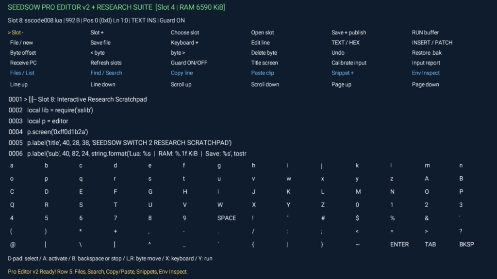
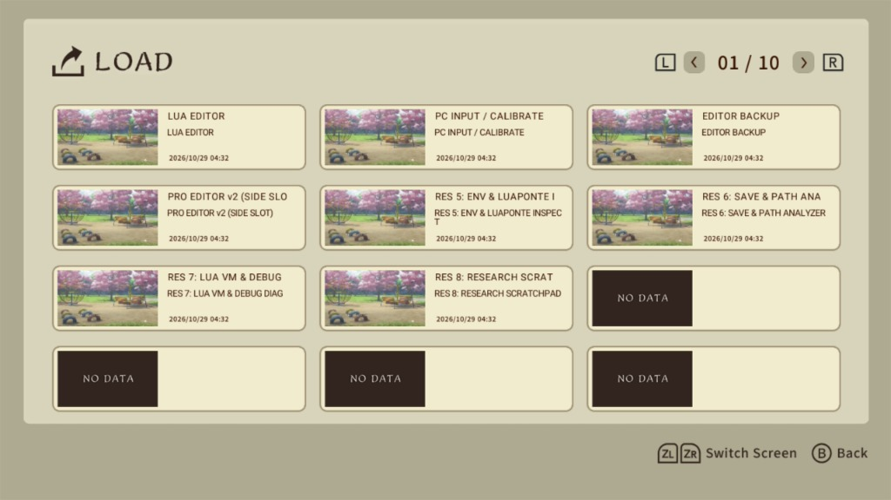

# seedsow-lua-editor-pro

Side-slot extension (`Slot 4`) for [DialingSpoon527/seedsow-lua-editor](https://github.com/DialingSpoon527/seedsow-lua-editor) on *Seedsow Lullaby* (Switch / Switch 2).

Slots 1–3 (`ssedit1..3.lua`) stay untouched as read-only V3 recovery editors. Slot 4 boots `pro_editor.lua` with extra tooling and runtime inspection scripts.

## Repository Layout

- [`src/`](src/) — Lua source files for Pro Editor v2 (`pro_editor.lua`), shared helper library (`sslib.lua`), and research slots (`sscode004.lua`–`sscode008.lua`).
- [`save/`](save/) — Complete JKSV save directory containing the base V3 save files plus the pre-installed Pro Editor and research slots.

## Added Features

- **5th toolbar row:**
  - `Files / List` — lists files in `s.savepath` with sizes and R/O status (`files_list.txt`).
  - `Find / Search` — text and hex search (`41 53 42 00` or ASCII) via native keyboard.
  - `Copy line` / `Paste clip` — persistent clipboard (`ed004-clipboard.txt`).
  - `Snippet +` — cycles through 6 starter Lua/Artemis templates.
  - `Env Inspect` — dumps `_G`, `engine` (`Luaponte` metatable + upvalues), and `debug.getregistry()` to `report_*.txt` and opens them in the editor.
- **Scrollable console:** 200-line `print()` buffer (use D-Pad Up/Down while a script is running).
- **Crash logging:** `xpcall` + `debug.traceback` writes full stacktraces with line numbers to `crash_log.txt`.
- **Editor tweaks:** Live Lua RAM counter, hex offset + `[XX]` cursor highlight in HEX mode, 40-step undo.

## Slots

| Slot | Script | Purpose |
| :--- | :--- | :--- |
| 1–3 | `ssedit1..3.lua` | Original V3 recovery editors (untouched) |
| 4 | `sscode004.lua` | Boots `pro_editor.lua` |
| 5 | `sscode005.lua` | Dumps `_G`, `engine` metatable/upvalues, and `debug.getregistry()` |
| 6 | `sscode006.lua` | Save directory file sizes, headers, and Adler32 scan (`report_files.txt`) |
| 7 | `sscode007.lua` | Lua VM, `debug`, and `pluto` check (`report_vm.txt`) |
| 8 | `sscode008.lua` | Fullscreen test loop with live hexdump |

Helper functions in `sslib.lua` (`hexdump`, `func_info`, `inspect_table`, `scan_globals`, `scan_engine`, `scan_registry`, `list_save_files`) can be loaded in any script with `local lib = require("sslib")`.

## Usage (JKSV)

1. Download `Seedsow_Pro_v2_JKSV.zip` from **Releases** (or copy the contents of [`save/`](save/)—including `.nx_save_meta.bin`—directly into the root of your JKSV backup folder).
2. Restore the save in JKSV on Switch 1, then transfer the save data to Switch 2 if needed.
3. Load **Slot 4** in-game (or load Slot 1 and run `sscode004.lua`).

## Credits

- [DialingSpoon527](https://github.com/DialingSpoon527/seedsow-lua-editor) for the base editor and `SIDE_SLOT` loader.
- Gezine for `ArtemisLuaLoader`.

*Note: Vibecoded and tested on real Switch hardware.*

